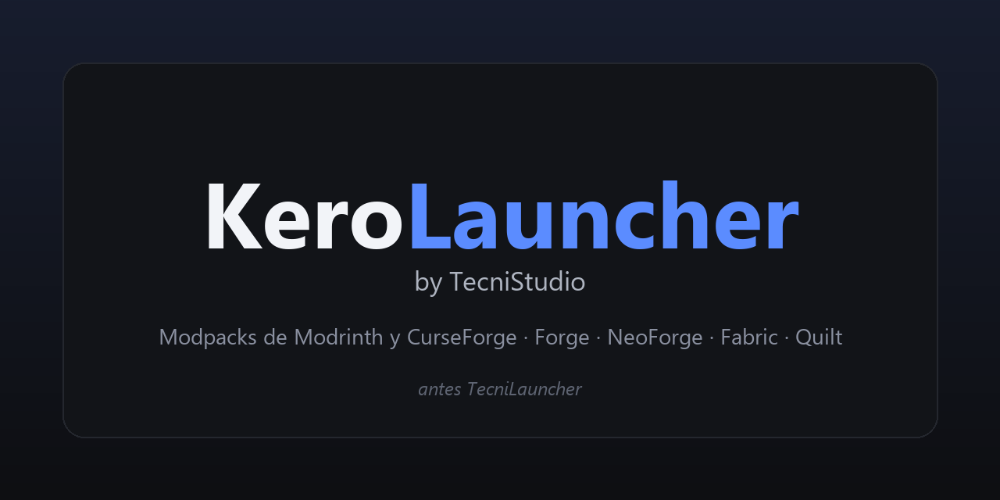

  

# KeroLauncher

**Un launcher de Minecraft para crear, gestionar y compartir tu experiencia de juego.**

> **Antes TecniLauncher.** Desde la versión 1.6.0 el launcher se llama **KeroLauncher** ("Kero", de Tecnikero). Es el mismo proyecto, con la misma historia: tus perfiles, mods y actualizaciones siguen igual. TecniLauncher es nuestro pasado y no lo olvidamos; KeroLauncher es lo que viene.

KeroLauncher es un launcher de escritorio desarrollado por **TecniStudio**, diseñado para simplificar la instalación de Minecraft, la administración de perfiles y modpacks, y la personalización del juego desde una sola aplicación.

Integra herramientas para gestionar mods mediante Modrinth y CurseForge, configurar distintas instancias, administrar clientes de TecniStudio y compartir configuraciones de juego.

  <a href="https://tecnistudio.online/launcher">
    <strong>Web oficial y descargas</strong>
  </a>
  ·
  <a href="https://github.com/Tecnikero/TecniLauncher/releases">
    <strong>Releases</strong>
  </a>
  ·
  <a href="https://tecnistudio.online/">
    <strong>TecniStudio</strong>
  </a>

---

## Características

### Gestión de Minecraft

* **Perfiles e instancias:** organiza distintas instalaciones y configuraciones de juego.
* **Múltiples versiones y loaders:** soporte para Vanilla, Forge, NeoForge, Fabric y Quilt.
* **Gestión de memoria RAM:** configura la memoria asignada a tus perfiles.
* **Tiempo de juego:** consulta el tiempo jugado por perfil o modpack.
* **Instalación de modpacks:** explora e instala modpacks compatibles desde Modrinth y CurseForge, con gestión de sus dependencias.

### Mods, shaders y texturas

* **Integración con Modrinth y CurseForge:** busca, descarga e instala mods y modpacks desde el launcher.
* **Dependencias automáticas:** instala las bibliotecas requeridas por los mods compatibles.
* **Shaders y paquetes de texturas:** busca e instala contenido visual directamente desde la aplicación.
* **Importación y exportación de instancias (Beta):** comparte configuraciones de juego mediante códigos, incluyendo mods, shaders y paquetes de texturas compatibles.

### Ecosistema TecniStudio

* **KeroClient (antes TecniClient):** TecniPvP con selector de versión y una pestaña de eventos, que pueden limitarse a ciertos jugadores.
* **Actualizaciones de clientes:** administra las instalaciones y actualizaciones disponibles desde su sección correspondiente.
* **Integración con skins:** utiliza las funciones de personalización de personaje compatibles con los servicios integrados.
* **Noticias y contenido:** accede a la información disponible desde el launcher.

### Experiencia de usuario

* Interfaz disponible en español, inglés y portugués brasileño.
* Actualizaciones automáticas y firmadas del launcher.
* Estadísticas de uso voluntarias, desactivadas por defecto ([qué se recopila](https://tecnistudio.online/privacidad.html#estadisticas-launcher)).
* Configuración persistente de perfiles y preferencias.
* Gestión de instancias independientes para mantener separadas las configuraciones de juego.

## Autenticación

KeroLauncher incorpora distintas modalidades de acceso, según el servicio y la configuración utilizados:

* **Microsoft:** para iniciar sesión con una cuenta de Minecraft compatible con la autenticación oficial.
* **TecniStudio:** integración con el servicio de autenticación y personalización compatible.
* **Modo offline:** permite iniciar el juego con un perfil local cuando la modalidad y el servidor de destino lo admiten.

**Importante:** el modo offline no sustituye una licencia ni equivale a la autenticación oficial de Microsoft. El acceso a servidores depende de los requisitos de autenticación de cada servidor.

## Descarga e instalación

1. Visita la [página oficial de KeroLauncher](https://tecnistudio.online/launcher).
2. Descarga la versión disponible para tu sistema.
3. Ejecuta el instalador o sigue las instrucciones proporcionadas con el archivo descargado.
4. Abre KeroLauncher y configura tu cuenta o perfil.
5. Crea una instancia o instala un modpack compatible y espera a que finalicen las descargas antes de iniciar el juego.

También puedes consultar las versiones publicadas en la sección de [Releases de GitHub](https://github.com/Tecnikero/TecniLauncher/releases).

## Seguridad y actualizaciones

KeroLauncher incorpora mecanismos destinados a mejorar la integridad de los datos y la seguridad de las instalaciones, entre ellos:

* Verificación mediante hash de archivos descargados en el sistema de actualizaciones.
* Protección frente a rutas de archivo no autorizadas durante determinadas operaciones de instalación y extracción.
* Guardado atómico de datos de perfiles y configuración.
* Mejoras en el manejo de modpacks y archivos descargados.

Estas medidas reducen determinados riesgos, pero no garantizan por sí solas que todos los archivos sean seguros. Descarga el launcher y sus actualizaciones desde los canales oficiales.

## Comunidad y soporte

¿Tienes dudas, encontraste un error o quieres compartir sugerencias?

* **Web oficial:** https://tecnistudio.online/
* **Página del launcher:** https://tecnistudio.online/launcher
* **Código fuente:** https://github.com/Tecnikero/TecniLauncher
* **Versiones y cambios:** https://github.com/Tecnikero/TecniLauncher/releases

Puedes utilizar los canales de la comunidad de TecniStudio para consultar novedades y solicitar ayuda.

Al informar de un problema, incluye la versión del launcher, los pasos para reproducirlo y, cuando corresponda, los registros relevantes. No compartas contraseñas, tokens de acceso ni otros datos privados.

## Historia del nombre

El proyecto nació como **TecniLauncher**, por TecniStudio. Con el tiempo, el nombre se confundía con otros launchers conocidos (Google llegaba a corregir "TecniLauncher" por otro nombre), así que en la 1.6.0 pasó a llamarse **KeroLauncher**, por el nick de su creador, Tecnikero. Su sección de clientes, TecniClient, pasó a llamarse **KeroClient**.

Por compatibilidad, algunos nombres internos siguen siendo los de siempre: el repositorio, el ejecutable `TecniLauncher.exe`, la carpeta de datos `.TecniLauncher` y el catálogo `tecniclients.json` de KeroClient. Así ninguna instalación existente pierde sus perfiles ni sus actualizaciones.

## Tecnologías e implementación

KeroLauncher cuenta con componentes para la gestión de perfiles, autenticación, comunicación HTTP, noticias, caché y actualizaciones.

La implementación y los requisitos concretos pueden consultarse en los archivos del repositorio.

## Licencia

Consulta los archivos del repositorio para conocer las condiciones de licencia y redistribución aplicables al proyecto.

---

Desarrollado por **TecniStudio**.

Minecraft es una marca de Mojang Studios y Microsoft. KeroLauncher es un proyecto independiente y no implica afiliación oficial con Mojang Studios ni Microsoft.
